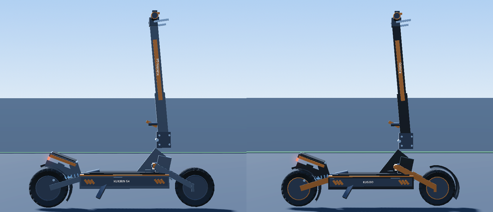

# 3D-модели

## 0. Godot-порт: модели собраны по реальным фотографиям

В Godot-версии самокаты строятся процедурно в `godot/scripts/scooter_model.gd`
(`ScooterModel.build(spec)`), форма сверялась по фотографиям реальных
KuKirin G4 и Kugoo F3 Pro Max. Бинарных ассетов в репозитории нет: вся геометрия —
примитивы и `SurfaceTool` (шины, крылья, спицы, протектор).



Слева — фото G4, справа — рендер из CI (`g4_1_side.png`). Снимок делается длиннофокусной
камерой (`fov 15°`, 6.2 м), чтобы перспектива не искажала сравнение.

### Что перенесено с фото

| Элемент | KuKirin G4 | Kugoo F3 Pro Max |
|---|---|---|
| Дека | короб-аккумулятор: низ на уровне осей, верх +0.10 м над осями; гриптейп, оранжевая кромка, шевроны, наклейка бренда | короб +0.095 м, чёрный, оранжевая кромка |
| Колёса | 11″: широкое кольцо-шина, 24 зубастых шашки, спицевой обод, кольцо по краю, тормозной диск снаружи | 10″: то же, кольцо обода оранжевое |
| Подвеска | рычаги (trailing arm) спереди и сзади с наклоном 12–18°, пружинные амортизаторы с витками | те же рычаги, оранжевые |
| Стойка | плоская труба 46–58 мм в глубину, наклон ~5° назад, замок складывания с болтами и быстросъёмом, руль на 1.22 м, деколь `KUKIRIN G4` | чёрная стойка с оранжевой полосой и деколью `KUGOO` |
| Зад | приподнятая площадка на треугольном кронштейне, стоп-сигнал на корме, крыло по шине | та же площадка, компактнее |
| Передок | крупная треугольная косынка от деки к стойке, фара в шее, **переднего крыла нет** | косынка + переднее крыло |

### Что упрощено (честный список)

* рычаги подвески — плоские пластины, а не фрезерованные профили с рёбрами;
* амортизатор — стакан и витки-кольца, без бачка и регулировок;
* обод — два диска и пять спиц на сторону, а не литой рисунок;
* шина — кольцо с шашками, без тонкого профиля боковины;
* надписи — `Label3D`, поэтому они не «запечены» в текстуру и вблизи выглядят условно;
* проводка, тросики, зеркала и ключ не моделируются;
* у F3 оранжевые кромки сделаны блоками, а не графикой с фото.

Размеры (база, высота деки, вылет руля) берутся из `ScooterSpec`, поэтому правка паспортных
данных меняет модель и физику вместе.

## 1. Unity-версия (архив, порт заброшен)

## 1.1. Что было сделано в Unity

Модели самокатов **процедурные**: собираются кодом из примитивов в `Assets/Scripts/Vehicle/ScooterFactory.cs`.
Это осознанное решение для репозитория без бинарных ассетов и без доступа к AI-генератору 3D в момент сборки.

Тем не менее, структура соответствует требованиям к моделям:

* масштаб **1 unit = 1 m**, forward = +Z (в Unity), origin — на уровне земли по центру деки;
* отдельные объекты: `WheelFront`, `WheelRear` (каждый со своим hub-мотором), `SteerAssembly`
  (руль + вилка + LCD + фара), `Body` (дека, маятник, амортизатор, стоп-сигнал, поворотники, ключ);
* материалы — URP/Lit (PBR: metallic/smoothness), процедурные текстуры 128×128 для дорожных покрытий;
* полигонаж низкий (примитивы), тени и LOD не требуются, что оптимально для Android.

Отличия моделей:

| | G4 | F3 Pro Max |
|---|---|---|
| Колёса | 11″, внедорожный протектор (14 грунтозацепов) | 10″, гладкий протектор (10 ламелей) |
| Хаб-моторы | только задний (спереди — заглушка оси) | передний и задний |
| Подвеска | вилка + маятник с амортизатором | вилка с передним амортизатором + задний |
| Акценты | холодный белый/сталь | оранжевый |
| Тормоза | 2 диска + 2 суппорта | 2 диска + суппорта + электронный тормоз |

## 2. Как подставить импортированный меш

1. Положите FBX/GLB в `Assets/Models/` (Unity импортирует самокат как префаб).
2. Убедитесь, что масштаб 1 unit = 1 m и forward = +Z, origin — по центру пятна контакта.
3. Разделите меш на части (или используйте пустышки-кости): `WheelFront`, `WheelRear`, `SteerAssembly`, `Body`.
4. В `ScooterFactory.Build` замените вызов `BuildModel(...)` на инстанцирование префаба:

```csharp
GameObject model = Object.Instantiate(spec.ModelPrefab, root.transform);
model.transform.localPosition = Vector3.zero;
frontPivot = model.transform.Find("WheelFront");
rearPivot = model.transform.Find("WheelRear");
steerVisual = model.transform.Find("SteerAssembly");
```

5. Добавьте в `ScooterSpec` поле `public GameObject ModelPrefab;` и загружайте его из `Resources`
   (например, `Resources.Load<GameObject>("Scooters/g4")`), если нужен один код на обе модели.
6. Ничего в физике менять не нужно: `ScooterController` управляет только трансформами
   `frontPivot`/`rearPivot`/`steerVisual` через `WheelCollider.GetWorldPose`.

## 3. Промпты для AI-генерации (из ТЗ, для внешнего использования)

### KugooKirin G4 (2026)

```
Детализированная 3D-модель электросамоката KuKirin G4 2026.
Чёрная алюминиевая рама, широкая дека (510×220 мм),
телескопическая рулевая стойка, регулировка высоты руля.
11" внедорожные пневматические шины.
Задний маятник с амортизатором, передняя вилка с амортизацией.
Задний привод: видимый задний хаб-мотор.
Передний и задний дисковые тормоза, тормозные машинки на руле.
LCD-дисплей по центру руля, кнопки газа/тормоза.
Фара, стоп-сигнал, поворотники (LED), ключ зажигания.
Складной механизм в основании рулевой стойки.
PBR-текстуры: чёрный матовый металл, резина, пластик.
Декали: логотип KuKirin, маркировка G4.
```

Негативный промпт:

```
low quality, blurry textures, toy look, cartoon style, wrong proportions,
too small wheels, smooth scooter tires without off-road tread, missing rear hub motor,
front hub motor (должен отсутствовать — привод только задний), two motors,
missing rear swingarm, missing shock absorber, missing front fork, missing disc brakes,
missing brake calipers, missing LCD display, missing headlight, missing taillight,
missing turn signals, missing key ignition, missing folding mechanism, floating parts,
merged wheels, no spokes, non-manifold geometry, overlapping UVs, rider included,
background, watermark, broken topology, high polycount, unriggable single mesh,
wrong scale, asymmetrical frame, missing deck, missing handlebar, wrong logo, text errors.
```

### Kugoo F3 Pro Max

```
Детализированная 3D-модель электросамоката Kugoo F3 Pro Max.
Чёрная алюминиевая рама, широкая дека, складная конструкция.
10" пневматические бескамерные шины.
ПОЛНЫЙ ПРИВОД: видимые передний и задний хаб-моторы.
Передняя и задняя подвеска (амортизаторы).
Передний и задний дисковые тормоза + электронный тормоз.
LCD-дисплей, кнопки управления, рычаги газа/тормоза.
Фара, стоп-сигнал, боковые габариты.
PBR-текстуры: чёрный/оранжевый акцент, металл, резина.
Декали: логотип Kugoo, маркировка F3 Pro Max.
```

Негативный промпт:

```
low quality, blurry textures, toy look, cartoon style, wrong proportions,
too large wheels, smooth tires without tread, missing front hub motor (должен быть — полный привод),
missing rear hub motor, single motor, missing front suspension, missing rear suspension,
missing disc brakes, missing brake calipers, missing electronic brake, missing LCD display,
missing headlight, missing taillight, missing side markers, missing folding mechanism,
floating parts, merged wheels, no spokes, non-manifold geometry, overlapping UVs,
rider included, background, watermark, broken topology, high polycount,
unriggable single mesh, wrong scale, asymmetrical frame, missing deck, missing handlebar,
wrong logo, text errors.
```

## 4. Требования к импорту для Android

* Трис: 15 000–40 000 на самокат (в игре один самокат — бюджет позволяет).
* Текстуры 2K достаточно (4K допустимо только для базы цвета, без mip-стриминга).
* UV: без перекрытий, non-manifold не допускается (нужен convex-меш для коллайдера, если решите
  заменить BoxCollider кузова).
* Rig: колесо/руль/подвеска отдельными объектами — для вращения из `WheelCollider.GetWorldPose`.
* Материалы: URP/Lit, metallic/smoothness-карты, эмиссия для фар/дисплея.
